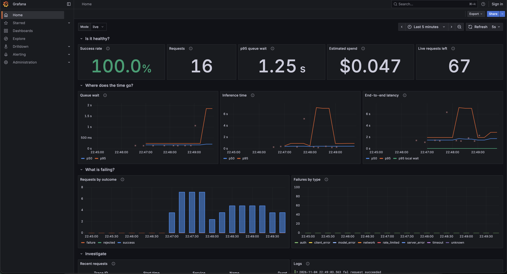
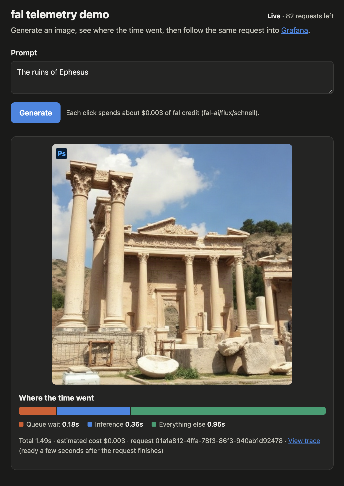
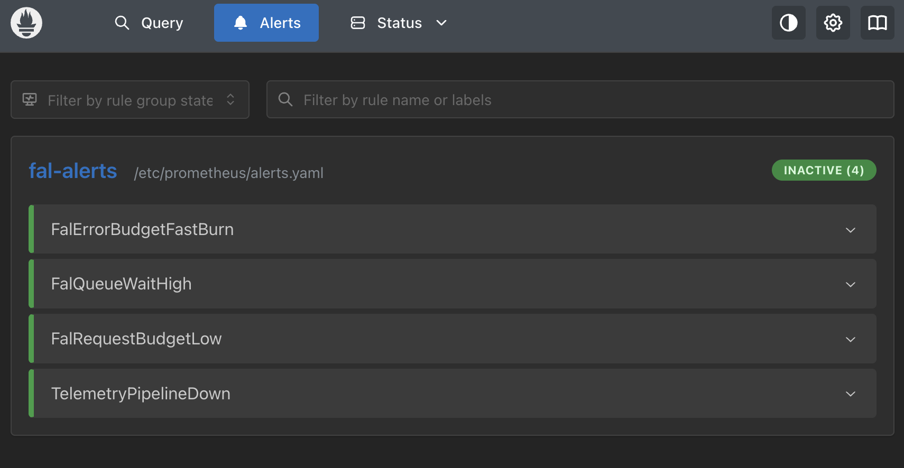
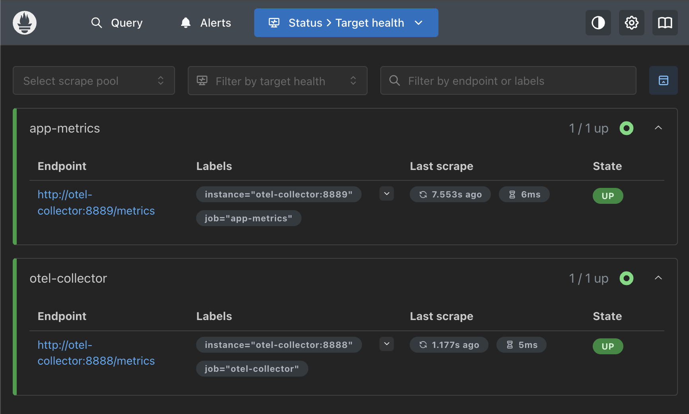

# fal API telemetry demo

A small FastAPI service that calls [fal](https://fal.ai) model APIs and reports how each call
behaved, using OpenTelemetry and an open-source Grafana stack.

The main idea: fal's queue API splits a request into **queue wait** and **inference**. They fail
for different reasons and call for different responses, so this project measures them separately
instead of reporting one latency number.

```
 loadgen ──> FastAPI app ──────────> fal queue API
                 │ OTLP
                 v
          OTel Collector ──> Prometheus (metrics, alert rules) ─┐
                         ──> Tempo      (traces)                ├─> Grafana
                         ──> Loki       (logs)                 ─┘
```

## Screenshots

**Grafana dashboard.** Real fal traffic in live mode: health, time per stage, failures, and links
into traces and logs. Inference p95 jumps to about 7s for a short stretch while queue wait stays
low, which a single latency number would hide.



**Web UI.** A real image from a live fal call, with the time split into queue wait, inference and
everything else.



**Prometheus alert rules.** All four rules loaded, none firing.



**Prometheus scrape targets.** App metrics and the Collector's own metrics are both up.



## Quick start

Needs Docker, plus [uv](https://docs.astral.sh/uv/) to run the tests. The default mode is `mock`,
which simulates fal's timing and failures and spends nothing.

```bash
cp .env.example .env
```

```bash
make up
```

```bash
make load
```

Then open the web UI at <http://localhost:8010> to generate an image and see where the time went,
with a link to that request's trace. The dashboard is at <http://localhost:3000>.

| Service | URL |
|---|---|
| Web UI | <http://localhost:8010> (in live mode, each click spends credit) |
| Grafana | <http://localhost:3000> (anonymous view; admin login uses `GRAFANA_ADMIN_PASSWORD`) |
| API docs | <http://localhost:8010/docs> |
| Prometheus | <http://localhost:9090> |

## Using real fal calls

Set `FAL_MODE=live` and `FAL_KEY` in `.env`, then run `make up`. `make load` expects the stack to
be running. Start with a single request, from the web UI or with curl:

```bash
curl -X POST localhost:8010/generate -H 'content-type: application/json' -d '{"prompt":"a red bicycle"}'
```

Then send a small batch, here 10 requests at one every 5 seconds:

```bash
LOAD_TOTAL=10 LOAD_RPS=0.2 make load
```

### What protects your credit

| Control | Default | Detail |
|---|---|---|
| Hard request cap | 100, about $0.30 | `FAL_MAX_REQUESTS`. Saved to a Docker volume, so restarts don't reset it. `docker compose down -v` does. |
| Fixed model and output | FLUX schnell, one 512x512 image | Set server-side. Callers only supply a prompt. |
| Load generator | Off | Only runs with `make load`. 30 requests by default, 200 at most. |
| Concurrency limit | 2 | `FAL_MAX_CONCURRENCY` |
| Timeouts | 60s to start, 120s total | Timed-out requests get a best-effort cancel. |

At the listed $0.003 per megapixel, rounded up, each image costs at most $0.003. The dashboard's
spend figure is an estimate, so check the fal billing page for the real number.

The API has no authentication and anyone who can reach it can spend your credit, so Compose binds
every port to `127.0.0.1`. Keep it that way, or add auth first.

## What gets measured

| Metric (Prometheus name) | Meaning |
|---|---|
| `fal_client_requests_total` | Attempts, by `outcome` and `error_type` |
| `fal_client_queue_duration_seconds` | Accepted by fal until processing started |
| `fal_client_inference_duration_seconds` | Processing time reported by fal (`metrics.inference_time`) |
| `fal_client_request_duration_seconds` | End to end, as seen by this client |
| `fal_client_local_wait_duration_seconds` | Held back by this app's own concurrency limit |
| `fal_client_submit_duration_seconds` | Time for the submit call, including SDK retries |
| `fal_client_queue_position` | Queue position at first status check |
| `fal_client_cost_usd_total` | Estimated spend |
| `fal_client_budget_remaining` | Live requests left before the cap |

Each trace has the spans `fal.submit`, `fal.queue_wait`, `fal.inference` and `fal.fetch_result`.
The signals are linked: exemplars on latency charts open traces, traces open their logs, and log
lines open their traces.

Prompts are not recorded, only their length. The API key is never logged.

## SLO and alerts

The SLO is 99% of requests succeeding. Rules are in [deploy/alerts.yaml](deploy/alerts.yaml), and
Prometheus evaluates them. No Alertmanager is included, so see firing alerts at
<http://localhost:9090/alerts>.

| Alert | Fires when |
|---|---|
| `FalErrorBudgetFastBurn` | Error rate above 14.4x budget over both 1h and 5m |
| `FalQueueWaitHigh` | p95 queue wait above 30s |
| `FalRequestBudgetLow` | Fewer than 10 live requests left |
| `TelemetryPipelineDown` | Prometheus can't scrape the Collector |

With a demo's low traffic, one failure can move these ratios a lot. The burn-rate windows assume
steady production traffic and are here to show the approach.

## Design notes

- **Counters start at 0.** Each `outcome` and `error_type` pair is created at startup. Prometheus
  can't see the increase in a series that first appears at 1, so the first failure of each type
  would otherwise go missing from rates and alerts.
- **Custom histogram buckets.** The OTel SDK's default buckets assume milliseconds, while these
  values are in seconds.
- **`error_type` is a fixed list,** which keeps metric cardinality bounded. Details go in logs.
- **`start_timeout` is always set.** `fal-client` retries timed-out POSTs unless this is set, and
  each retry could be billed without counting against the cap. Connection errors can still be
  retried by the SDK.
- **Polls don't create spans.** One HTTP span per poll would bury the phases that matter.
- **Budget rejections don't count against the SLO.** They are this app's choice, not a fal failure.

## Known limits

- Queue wait is measured by polling, so it is accurate to about the 0.2s poll interval. If polling
  misses `IN_PROGRESS`, the boundary is derived by subtracting fal's reported inference time.
- This is a single-node demo stack: local storage, no auth, no high availability.
- The budget cap assumes one app instance.

## Development

```bash
make test
```

```bash
make lint
```

Edit the dashboard in [scripts/build_dashboard.py](scripts/build_dashboard.py), not the generated
JSON, then regenerate it:

```bash
uv run python scripts/build_dashboard.py
```
